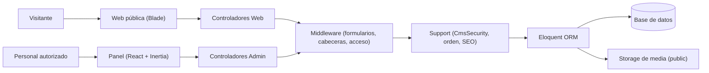
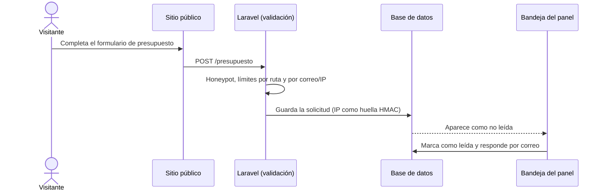
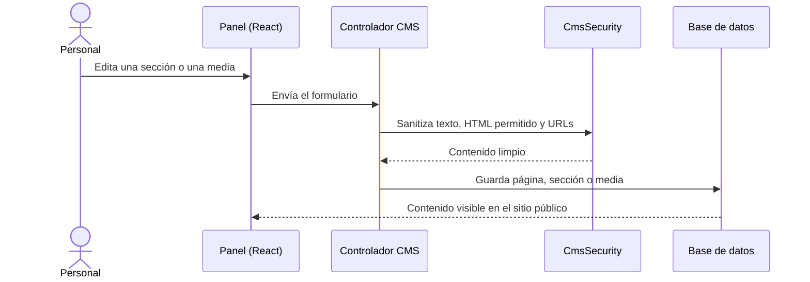
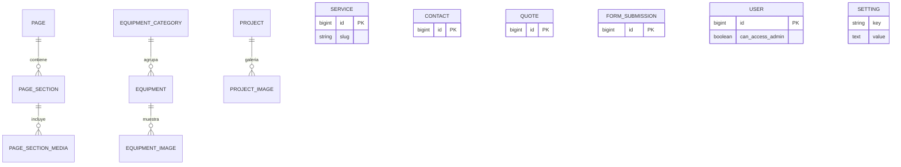

<div align="center">

<br/>

**Sitio corporativo industrial con panel CMS y bandeja unificada de presupuestos.**


</div>


##  Contenido

[El problema](#-el-problema) · [La solución](#-la-solución) · [Funcionalidades](#-funcionalidades) · [Arquitectura](#-arquitectura) · [Flujos de trabajo](#-flujos-de-trabajo) · [Modelo de datos](#-modelo-de-datos) · [Criterios y decisiones](#-criterios-y-decisiones) · [Stack](#-stack) · [Estructura](#-estructura-del-repo) · [Puesta en marcha](#-puesta-en-marcha) · [Pruebas y calidad](#-pruebas-y-calidad) · [Despliegue](#-despliegue) · [Estado y pendientes](#-estado-y-pendientes) · [Licencia y autoría](#-licencia-y-autoría)


##  El problema

Una empresa industrial que vende calderas y equipos necesitaba dos cosas que no convivían bien: un sitio que mostrara servicios, equipos y trabajos realizados a potenciales clientes, y una forma de recibir consultas comerciales sin depender de plantillas o de intervenir la base de datos para cada cambio de contenido.

Sin una herramienta propia, cada actualización de un servicio, una ficha de equipo o una foto de obra dependía de quien pudiera tocar el código, y las solicitudes de contacto y presupuesto llegaban dispersas.

##  La solución

**Calderas Hercal** es una aplicación Laravel con dos caras:

- **Sitio público** para visitantes y clientes potenciales: inicio, empresa, servicios, equipos, trabajos realizados, clientes, contacto y solicitud de presupuesto. Se renderiza en servidor con Blade.
- **Panel administrativo** para el personal autorizado: edición de páginas por secciones, catálogos, proyectos, multimedia, SEO y la bandeja de solicitudes. Se construye con React e Inertia.js.

El acceso al panel exige sesión autenticada y el permiso explícito `can_access_admin`. El personal edita contenido; el diseño de las páginas no cambia.


##  Funcionalidades

**Sitio público**
- Inicio, empresa, servicios, equipos, trabajos realizados, clientes y búsqueda de servicios, equipos y proyectos.
- Detalle de servicios y equipos por slug, con navegación por categorías.
- Formularios de contacto y de presupuesto con selección contextual del servicio o equipo consultado.
- Enlace directo a WhatsApp configurable desde el panel.

**Panel administrativo** (rol: personal autorizado)
- CMS de páginas, secciones y recursos multimedia: imágenes, videos locales y videos de YouTube, con texto alternativo, orden y activación independiente.
- Catálogos de servicios, categorías de equipos, equipos y proyectos, con orden, estado activo y selección de contenido destacado en inicio.
- Bandeja unificada de contactos y presupuestos: búsqueda, filtros, estado leído/no leído y enlace de respuesta por correo.
- Metadatos SEO por página: título, descripción, palabras clave, URL canónica, directivas para robots e imagen Open Graph.
- Usuarios, avatar, perfil y cambio de contraseña.


##  Arquitectura

Monolito Laravel que comparte modelos, reglas, almacenamiento y autenticación entre dos formas de presentación: Blade para la web pública y Inertia para el panel. No existe una API REST pública ni versionada; algunas rutas internas del CMS responden JSON.






##  Flujos de trabajo

**Solicitud de presupuesto desde el sitio público**



**Edición de contenido en el CMS**




##  Modelo de datos

Persistencia con Eloquent. Las migraciones definen claves foráneas, borrado en cascada donde corresponde, slugs y correos únicos, e índices para orden, relaciones y estado de lectura.



Las solicitudes de contacto y presupuesto también quedan en `form_submissions`, la tabla que alimenta la bandeja unificada. Las categorías de equipos conservan su portada con la bandera `is_catalog_root`, y las operaciones que la sincronizan usan transacciones.


##  Criterios y decisiones

Reglas de negocio e invariantes que no se leen a simple vista en el código:

- **Una sola portada por categoría.** `is_catalog_root` separa la representación de una categoría de sus productos, para no duplicarla en la navegación pública.
- **Sin HTML arbitrario en el CMS.** El texto enriquecido pasa por una lista de etiquetas permitidas; se filtran atributos de eventos, estilos y esquemas de URL no admitidos.
- **SVG no admitido como media de página.** Las cargas validan tipo MIME, extensión y tamaño.
- **IP nunca en texto plano.** Las solicitudes guardan una huella HMAC.
- **El usuario principal no se puede quitar.** La administración de usuarios impide retirar su acceso o eliminar la propia cuenta desde la pantalla de gestión.
- **Acceso por permiso, no por rol.** La autorización del panel se resuelve con `can_access_admin`; existe una lista de correos de compatibilidad configurada por entorno.

| Decisión | Por qué |
| --- | --- |
| Monolito Laravel con Blade y React/Inertia | Una sola base de código y un solo backend; la web pública necesita SEO por render en servidor y el panel necesita interacción sin una API independiente. |
| CMS modelado en entidades relacionadas | Páginas, secciones y media se ordenan y activan por separado en vez de guardarse como un bloque opaco. |
| Sanitización centralizada en `CmsSecurity` | Un único punto para texto, HTML, URLs, correos, teléfonos y huellas de IP. |
| Honeypot y doble límite de frecuencia | Reducen spam en formularios públicos sin pedir captcha al visitante. |


##  Stack

| Capa | Tecnología | Versión |
| --- | --- | --- |
| Lenguaje | PHP | ^8.3 |
| Backend | Laravel framework | 12.x (lock 12.69.2) |
| Integración panel | inertiajs/inertia-laravel | 2.0.22 |
| Autenticación | Laravel Breeze | según `composer.json` |
| Frontend | React | 18.3.1 |
| Frontend | @inertiajs/react | 2.3.18 |
| Estilos | Tailwind CSS | 4.2.1 |
| Build | Vite | 7.3.6 |
| Pruebas | PHPUnit | 11 |
| Base de datos | SQLite por defecto (MySQL, MariaDB, PostgreSQL y SQL Server soportados por configuración) | — |


##  Estructura del repo

```text
app/Http/Controllers/Web/     sitio público (inicio, servicios, equipos, presupuesto)
app/Http/Controllers/Admin/   CMS, catálogos, usuarios y solicitudes
app/Http/Middleware/          acceso administrativo, formularios y cabeceras
app/Support/                  orden, seguridad del CMS y resolución SEO
database/migrations/          esquema relacional
database/seeders/             contenido inicial de las páginas
resources/views/              Blade público y correos
resources/js/                 panel React e Inertia
routes/web.php                rutas públicas y administrativas
tests/                        pruebas de funcionalidad y unitarias
```


##  Puesta en marcha

Requisitos: PHP 8.3+, Composer, Node.js y npm.

```bash
composer install
npm ci
cp .env.example .env
php artisan key:generate
touch database/database.sqlite   # configuración SQLite incluida
php artisan migrate --seed
php artisan storage:link
composer run dev                 # servidor, cola, logs y Vite en paralelo
```

Alternativa: `php artisan serve` y `npm run dev` por separado.

Variables de entorno: revisar `.env.example` (base de datos, correo, `APP_URL`, y las que configuran el acceso administrativo). Los valores reales van en `.env`, que no se versiona.


##  Pruebas y calidad

Pruebas en `tests/Feature` y `tests/Unit`: autenticación, perfil, autorización del panel, protección de formularios, cabeceras HTTP, rechazo de SVG, visibilidad del CMS, reglas del catálogo y selección contextual en presupuestos.

```bash
composer test
npm run build
```

La cifra registrada en la versión anterior de este README fue de 41 pruebas y 130 aserciones aprobadas, sobre SQLite en memoria; no se volvió a ejecutar para este cambio. No hay linters frontend, análisis estático, E2E ni pruebas de carga configurados.


##  Despliegue

No documentado en el repositorio. No hay Dockerfile, Docker Compose, configuración de servidor web ni pipeline CI/CD versionados. El proveedor, entorno y procedimiento de producción no se pueden verificar desde el código.


##  Estado y pendientes

- **Estado:** demo funcional. El código incluye sitio público, panel, persistencia, migraciones, seeders y pruebas automatizadas.
- **Último commit:** 2026-06-06, `VERSION 1.0.1`, en el historial local.
- **Producción:** no verificado.
- **Pendientes técnicos:** definir despliegue y procedimiento operativo; añadir análisis estático o pruebas E2E si el cliente las requiere.


##  Licencia y autoría

Desarrollado por el **Ing. Santiago Abasto**.


Repositorio sin archivo de licencia. El código y el contenido son propiedad del cliente, Calderas Hercal, salvo que se acuerde otra cosa.
